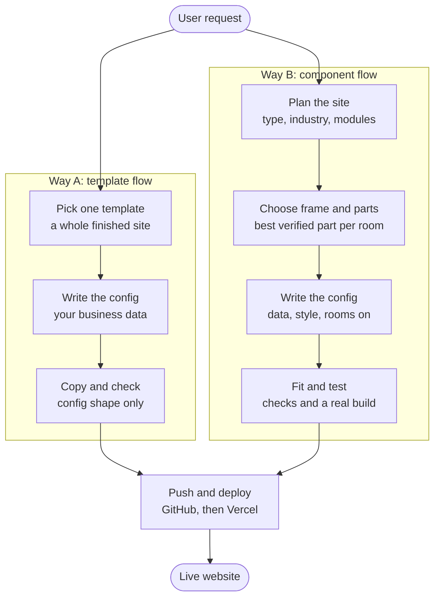
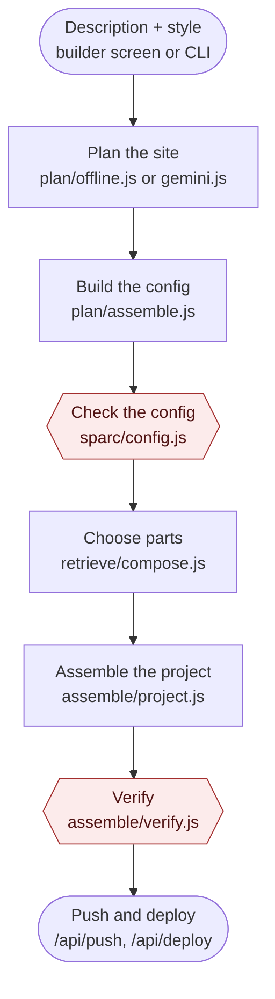
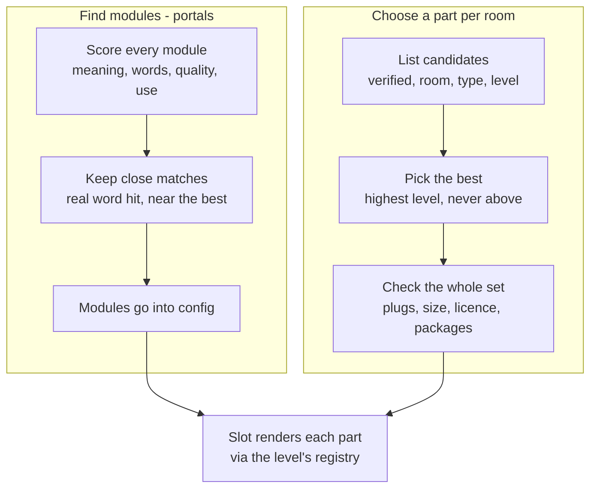

# SPARC AI: how the whole project works

One page to understand everything: the two ways of building a website, the five website types, what is written in advance, how parts are matched, ranked and placed, how a site is tested, pushed and deployed.

---

## 1. The big picture

The platform builds a website in **two ways**. Both take a request, both end with a live website. They differ in *what the site is made of*.

Flowcharts (they draw in GitHub and in a VS Code Markdown preview; a plain-text version follows):



The code path of Way B, with the file that does each step (red = a gate that can stop the build):



How parts are ranked and chosen:



Plain-text version:

```
                          USER REQUEST
              (describe it, or fill the wizard / form)
                               |
            +------------------+------------------+
            |                                     |
   WAY A: TEMPLATE FLOW                  WAY B: COMPONENT FLOW
   (the original prototype)              (SPARC AI)
            |                                     |
   pick ONE ready template               plan the site, then pick the best
   (a whole finished site)               verified part for every spot
            |                                     |
   write a config                        write a config
   (your business data)                  (business data + style + parts)
            |                                     |
   copy template + config                assemble frame + parts + config
            |                                     |
   check the config                      check config, parts, and a real build
            |                                     |
            +------------------+------------------+
                               |
                      PUSH to GitHub  ->  DEPLOY to Vercel
                               |
                          LIVE WEBSITE
```

**One-line difference:** Way A fills one fixed template. Way B builds the site from small, tested, reusable parts and writes **no new code** per site.

---

## 2. Way A: the template flow

```
 INPUT                FRAME / TEMPLATE         CONFIG
 -----                ----------------         ------
 wizard or            one of the ready         content.json (landing pages)
 describe-it  --->    templates, copied   ---> or portal config (portals):
 (AI writes the       as a whole               brand, modules, fields, theme
 landing config)
                                                    |
        +-------------------------------------------+
        v
 FIT + CHECK            PUSH                 DEPLOY
 -----------            ----                 ------
 config is cleaned      files go to a        Vercel builds it.
 and checked            new GitHub repo      Portals also get their own
 (zod rules)            (private)            Supabase database first
```

| Step | What happens |
|---|---|
| Input | The user fills a wizard (portals) or describes the site and Gemini writes the content config (landing/portfolio templates). |
| Frame | One complete template is chosen: `landing-modern`, `landing-temp-2`, `portal-admin`, `crud-modern-new-temp` (a fifth, `portal-admin-v2`, is hidden). |
| Config | A JSON file: `content.json` for landing pages; for portals the brand, modules, fields, login text, theme colour. |
| Fit | The config is cleaned and checked against fixed rules. The template is copied and the config written in. |
| Test | The config shape is checked. The generator itself has regression tests. **The finished site is not tested.** |
| Push / Deploy | `/api/push` creates the GitHub repo, `/api/deploy` deploys to Vercel. For portals, `/api/portal/provision` first creates a Supabase project and its tables. |

**Limit:** it can only build what a template exists for (no landing-page type of its own, no store, no booking site) and every template is its own copy of code.

---

## 3. Way B: the component flow (SPARC AI)

```
 1 INPUT          2 PLAN                 3 CONFIG
 -------          ------                 --------
 description      type, industry,        a short config:
 + style level -> modules, rooms,   ---> business data + style level
 (Basic..         brand name             + which rooms are on
  Astonishing)    (offline rules
                   or Gemini)                |
                                             v
 4 FRAME + PARTS                    5 FIT + TEST
 ---------------                    ------------
 the frame (shell) for the type     config check   -> is it valid?
 + the best VERIFIED component      parts check    -> do they fit together?
 for every room, at the chosen      checklist      -> does every room have a part?
 style level                        real build     -> does it compile and bundle?
                                             |
                                             v
                          6 PUSH  ->  7 DEPLOY  (same as Way A)
                          + sparc.lock.json: exactly which part version was used
```

| Step | What happens |
|---|---|
| Input | A plain description and a style level. In the builder screen the user can then edit everything. |
| Plan | Decides website type, industry, which library modules to reuse, and a brand name. Offline rules work with no key; Gemini is the second engine. Both give the same kind of answer and a bad Gemini answer falls back to the offline one. |
| Frame | A shell chosen by website type (section 6). It holds the logic: pages, login, data, cart, slots. |
| Parts | For every room, the best **verified** component at or below the chosen style level (section 9). |
| Config | Brand, theme, style, enabled rooms, plus the business data (modules and fields, products, services, section text). |
| Fit | Rooms get their parts through the registry of the chosen style level. Parts are checked against each room's plug shape. |
| Test | Config check, part-compatibility check, config checklist, and a **real Vite build**. All must pass before anything is pushed. |
| Push / Deploy | Same buttons as Way A. The project also holds `sparc.lock.json` so the same request can be rebuilt identically. |

---

## 4. The two ways, side by side

| | A: Template flow | B: Component flow |
|---|---|---|
| Made of | One whole template | Frame + verified parts |
| New code per site | A copy of the template | **0 lines** (config only) |
| Website types | Portal, portfolio | Portal, portfolio, landing, store, booking |
| Choice of look | The template's look | 4 style levels, per type |
| AI's job | Write a config | Write a config (plan) |
| Checks before deploy | Config shape | Config, parts, checklist, real build |
| Repeatable | Same config, same site | Same request, same site (30 of 30 in the evaluation) |
| Add a new look | Write a new template | Add a skin or a part, every site can use it |

Measured on the 30 evaluation requests: the component flow covered 30 of 30; the template flow could serve 17 of 30. Details: `docs/EVALUATION.md`.

---

## 5. What website types we build now

Five types are active. Each has a **blueprint**: a JSON file listing its rooms (spots), pages, optional rooms, and the highest style level allowed.

| Type | Rooms (must / optional) | Pages | Highest style | Industries |
|---|---|---|---|---|
| **Admin portal** | 12 / 9 | login, sign-up, forgot-password, dashboard, a list + add + edit + detail page for every module, profile, settings, users | Amazing | healthcare, CRM, HR, school, inventory, ERP, generic |
| **Portfolio** | 7 / 8 | one long page | Astonishing | none |
| **Landing page** | 6 / 10 | one long page | Astonishing | generic, healthcare, school, CRM |
| **Online store** | 9 / 4 | home, product page, cart, checkout and payment, order confirmation | Amazing | inventory, generic |
| **Booking site** | 8 / 4 | one page (service, day and time, details), confirmation | Amazing | healthcare, school, generic |

Not built yet: shop admin, customer accounts, coupons, reviews, booking reminders. (The admin-portal type can serve as the shop or booking admin by adding an "orders" or "bookings" module.)

---

## 6. The frame (the "dhaancha")

The frame is the part that is the same for every site of a type. It owns the **logic**; it never decides the **look**.

```
 +-----------------------------------------------------------+
 |  FRAME (shell)                                            |
 |   routes + pages        login / session                   |
 |   data (Supabase or demo)   cart, payment, slots, forms   |
 |   theme (colour, corner size, spacing, button size)       |
 |                                                           |
 |   +--------+  +--------+  +--------+  +--------+          |
 |   | room:  |  | room:  |  | room:  |  | room:  |   ...    |
 |   | navbar |  | hero   |  | cart   |  | footer |          |
 |   +--------+  +--------+  +--------+  +--------+          |
 |      ^           ^           ^           ^                |
 |      |           |           |           |                |
 |   a component fills each room, picked from the library    |
 +-----------------------------------------------------------+
```

| Frame | Used for | Holds the logic for |
|---|---|---|
| `portal-shell` | Admin portal | login, session, data pages (table, search, filter, sort, add, edit, delete, export), dashboard, users and roles |
| `site-shell` | Portfolio, landing page, store, booking | one-page sections, menu, contact and newsletter forms, **cart and payment** (store), **slot choice and booking** (booking site) |

Because the logic lives once in the frame, changing a component's look **cannot break** how the site works.

---

## 7. Rooms, plug shapes and style levels

### Rooms (51)
A **room** is a named spot with a **plug shape**: the exact props any component in that spot must accept. Any component, at any style level, fits the same plug.

| Group | Rooms |
|---|---|
| Layout and feedback (6) | navbar, footer, app-frame, not-found, empty-state, notifications |
| Content, visual (17) | hero, about, projects, skills, experience, education, services, stats, testimonials, resume-download, contact, pricing, faq, team, gallery, location-map, cta-banner |
| Forms (7) | contact-form, newsletter, form-field, record-form, profile, settings, file-upload |
| Login (3) | login, signup, forgot-password |
| Data (8) | dashboard-stat-card, dashboard-chart, record-detail, activity-log, data-table, filter-bar, export-button, users-roles |
| Store (5) | product-list, product-page, cart, checkout-payment, order-confirmation |
| Booking (4) | services-list, slot-picker, booking-form, booking-confirmation |
| Dialog (1) | confirm-dialog |

*Visual* rooms get a component for every style level. *Workflow* rooms (they act: forms, tables, cart, booking) have Basic and Good for now.

### Style levels (rules a component must obey)

| Level | Look | Packages allowed | Size limit (per component) | Motion |
|---|---|---|---|---|
| **Basic** | clean, plain, fast | none extra | 15 KB | none |
| **Good** | polished: soft shadows, hover lift | none extra | 20 KB | CSS only |
| **Amazing** | modern with animation | `motion` | 60 KB | JavaScript, respects reduced-motion |
| **Astonishing** | wow effects | `motion`, `gsap` | 150 KB | JavaScript, respects reduced-motion |

A site at Amazing needing a workflow room that only has Good uses the Good one automatically.

---

## 8. What is written in advance

| Pre-written thing | What it is | Where |
|---|---|---|
| **Blueprints** (5) | rooms, pages, optional rooms, style ceiling per type | `sparc/blueprints/` |
| **Room contracts** (51) | the plug shape of every room, as data | `sparc/rooms.js` |
| **Style-level rules** | packages, size, motion, accessibility rules | `sparc/styleLevels.js` |
| **Component library** | 166 verified components (views once, skins per level) | `sparc-ui/library/` |
| **Field types** (27) | every kind of input a record can have | `lib/fieldTypes.js` |
| **Modules** (33) | ready-made record types with their fields | `sparc/modules.js` |
| **Industry defaults** | login text, theme colour and starter modules per industry | `lib/portalConfig.js`, blueprints |
| **Starter content** | editable placeholder sections, 3 products, 3 services | `registry/plan/assemble.js` |
| **Sample configs** | a tea shop, a clinic booking site, a portfolio, a landing page | `sparc-ui/shells/*/src/configs/` |
| **Templates** (Way A) | 4 visible whole templates | `templates/` |

### Field types (27) and the 9 input components that cover them

| Input component | Field types |
|---|---|
| text input | text, email, password, phone, url, color |
| textarea | textarea |
| number input | number, currency, percentage, rating |
| choice | select, radio |
| multi-choice | multi-select, checkbox-group, tags |
| yes/no | checkbox, toggle |
| date and time | date, time, datetime |
| file or image | file, image, avatar |
| structured | address, json, reference |

### Modules (33), by industry

| Industry | Modules |
|---|---|
| Healthcare | patients, appointments, doctors, prescriptions |
| CRM | contacts, leads, deals, customers |
| HR | employees, leave-requests, attendance, payroll |
| School | students, teachers, fees, exams, courses |
| Inventory | products, suppliers, stock-movements, orders |
| ERP | vendors, purchase-orders, invoices, expenses |
| General | tasks, bookings, tickets, projects, assets, events, feedback, documents |

Each module is a record type: a name, an icon, its fields (each with one of the 27 field types), and the list columns.

---

## 9. Matching, ranking and placing

### 9.1 From description to a filled site

```
 "A clinic website to manage patients and appointments"
                      |
                      v
 PLAN   website type  -> admin portal       (words: manage, admin, shop, book, portfolio ...)
        industry      -> healthcare         (words: clinic, patient ...)
        style level   -> good (default, or from words / the user's choice)
        brand name    -> from a quoted or capitalised name
        modules       -> patients, appointments, doctors ...   (search, 9.2)
                      |
                      v
 CONFIG   expand each module into its fields (never invented), add theme,
          rooms on/off, login text   ->  checked by the config rules
                      |
                      v
 COMPOSE  for every room the type needs, pick one component   (9.3)
                      |
                      v
 ASSEMBLE copy frame + parts + config + lock into one project
```

A tie in the website-type words goes to *admin portal*, so older descriptions keep planning the same way.

### 9.2 Ranking modules (search)

A description is matched against the 33 modules (and any component) with a hybrid score. Hard filters come first (kind, trust, website type), then each candidate is scored:

```
 score  =  0.45 x meaning match      (text embeddings: Gemini, or an offline one)
         + 0.30 x keyword match      (words + synonyms)
         + 0.15 x quality            (size, accessibility problems cost points)
         + 0.10 x usage              (past use, when it has been recorded)
```

A module is kept when a keyword really matches **and** its score is close to the best one. A module the user names directly is always kept. Too few matches: the industry's home modules are added. Measured: Recall@5 = 1 and MRR = 1 on 32 labelled queries.

### 9.3 Selecting a component for each room

```
 for each room the site needs:

   candidates = components that are
                  - VERIFIED            (only our own library can be)
                  - for this room
                  - allowed for this website type
                  - at the chosen style level or the closest LOWER one

   best = the highest level available (never above the choice);
          the standard "sparc" component wins; ties go by name (stable)

 then the WHOLE set is checked together:
   - every component fits its room's plug shape
   - style level within the website type's ceiling
   - peer-package ranges (React, Tailwind) agree
   - licences are reusable
   - no room is left without a component
```

If anything fails, the build stops with a clear list. Nothing half-working is pushed.

### 9.4 How a part is placed

The frame never imports a specific component. It renders `<Slot room="cart" props={...}/>`. A small **registry file for the chosen style level** says which component fills each room. A generated site ships **only its own level's registry**. Every component is also wrapped so that if one crashes, only that spot shows a friendly message, not the whole page.

---

## 10. Where parts come from, and the trust rule

```
 SOURCES                              LIBRARY (catalogue of 899 labels)
 -------                              ---------------------------------
 our own library        ----------->  VERIFIED  (166)   <- only these can be built
 our own templates      ----------->  candidate
 shadcn / MagicUI /     ----------->  candidate
   Aceternity
 npm, GitHub, Storybook ----------->  candidate (metadata only)
```

Every item gets a **label** (name, room, style level, props, packages, licence, size, accessibility result, trust). Parsers and the source fill the facts; AI may only write short descriptions.

**Trust rule:** a build may use **only verified** components. Outside parts are searchable and can be recommended to people, but are **never added automatically**. This keeps the old accuracy intact. A part becomes verified only after it fits its room, stays within its style level's size and package rules, has no serious accessibility problems and has a reusable licence.

How a part is built: the **structure of a room is written once** (a view), and each style level adds only its **look** (a skin). So the logic is written once and the looks are many.

---

## 11. The config (what makes a site yours)

One JSON file holds the business data. Small examples:

```json
// Online store
{ "websiteType": "ecommerce", "styleLevel": "good",
  "brand": { "name": "Chai & Co" }, "theme": { "primary": "#b45309" },
  "store": { "currency": "INR", "payment": { "mode": "test" } },
  "sections": { "hero": { "title": "Tea worth slowing down for" },
                "product-list": { "products": [ { "id": "assam-breakfast", "name": "Assam Breakfast", "price": 349 } ] } },
  "rooms": { "enabled": ["faq"] } }
```

```json
// Admin portal
{ "websiteType": "admin-portal", "styleLevel": "amazing", "industry": "healthcare",
  "brand": { "name": "Sunrise Clinic" },
  "modules": [ { "id": "patients", "fields": [ { "key": "name", "type": "text", "required": true } ] } ] }
```

Booking sites carry `booking.services` and `booking.availability` (days, hours, step, how far ahead). Portfolios and landing pages carry text for each section.

---

## 12. Fit and test: every check, in order

| Stage | Check | Stops the build if... |
|---|---|---|
| Config | shape, style within the type's ceiling, only valid optional rooms, unique ids, valid fields, valid products, prices, services, hours | anything is wrong |
| Plan | a bad AI answer is cleaned; an empty portal is repaired; last resort is a minimal valid portal | (never stops: always falls back) |
| Parts | room contract, size, packages, licence, accessibility, one version per room | a room has no part, or parts clash |
| Checklist | every needed room has a part; portals have modules with required fields and options; sites have content for each switched-on section; stores have products and a payment setup; booking sites have services and hours | any item fails |
| Build | a real Vite build compiles and bundles the project | the build fails |
| Library (before a part is verified) | contract test, accessibility scan (axe), size budget, reduced-motion test | the part is not verified |
| Whole repository | regression tests keep the old flow's output identical | any recorded output changes |

Not done yet: tests run in a real browser on the finished site (Playwright), and Lighthouse scores.

---

## 13. Push and deploy

```
 verified project folder
          |
   POST /api/push     ->  new private GitHub repo with the files
          |
   POST /api/deploy   ->  Vercel project from that repo  ->  live URL
```

Portals also get a **Supabase project** created first (tables, security rules, admin user with a random password). The same two buttons serve both ways. A store starts in **practice-card payment mode**; real Razorpay or Stripe needs a server function the owner supplies (`docs/PAYMENTS.md`). Tried live: Gemini plan, GitHub push, Vercel deploy.

---

## 14. Safety

| Concern | How it is handled |
|---|---|
| Old accuracy | New features only add; regression tests keep every old output identical |
| AI mistakes | The AI never writes code or invents fields; its answer is checked and can fall back to offline rules |
| Outside code | Only verified (our own, fully checked) components are built |
| Same request, same site | Fixed versions are written to `sparc.lock.json` |
| Login | Server-checked signed tokens; the API sits behind login |
| Payments | Practice cards by default; real gateways go through a server function that checks the gateway's signature; the page holds no keys and sends no card data |
| Secrets | Kept in the server's environment, never in the generated website |

---

## 15. Where things live

```
 platform-main/          the website you use (React): gallery, wizard, builder screen
 platform-backend-main/
   index.js              original API: templates, config, portal, push, deploy
   lib/                  config rules, field types, login
   templates/            Way A: whole templates
   sparc/                Way B data: blueprints, rooms, style levels, modules, config checker
   sparc-ui/             frames (shells), core logic, component library
   registry/             catalogue, search, planner, composer, assembler, evaluation
   docs/                 this file, scope, library status, payments, evaluation, user study
```

---

## 16. Status in one table

| Part | State |
|---|---|
| Template flow | Works as before (unchanged) |
| Component flow, 5 website types | Works. 30 of 30 evaluation requests covered, all built |
| Builder screen (describe, edit, build, push, deploy) | Works |
| Live Gemini, GitHub push, Vercel deploy | Tried once, worked |
| AI-writes-all-code comparison, Gemini planner numbers | **Not measured** (Gemini quota ran out) |
| User study on style levels | **Not done** (needs real people) |
| Real Razorpay / Stripe | **Not tested** |
| Shop admin, customer login, booking reminders | Not built |
| Amazing / Astonishing skins for the workflow rooms | Not built |
